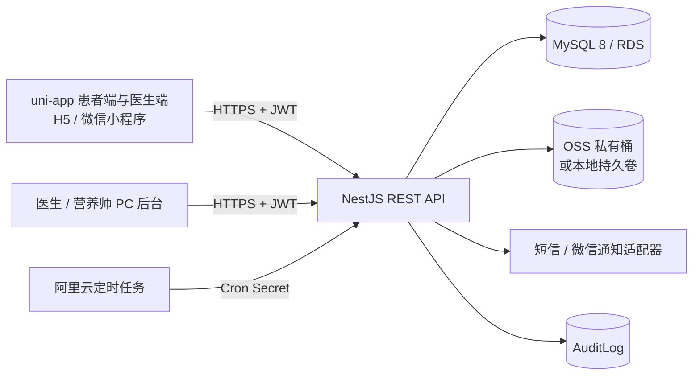

# 架构与权限设计

系统采用模块化单体，适合先部署到单台 ECS，再按吞吐拆分：

- Auth：Argon2id、短信挑战、微信 `jscode2session`、短效 access token、refresh token 轮换与重放撤销。
- Care：可配置有效期/使用次数的邀请码；预览与确认绑定分离；绑定和解绑写审计。
- Records：体重、四餐饮食（含加餐）及兼容健康记录，7/30/90 天聚合报告。
- Tasks / Follow-ups：后端状态机、批量与重复计划、患者结构化结果、完成通知。
- Care Summaries：医生/营养师按自然周或自然月聚合体重、饮食、运动和任务数据，保存点评快照并向患者发送站内深链通知；同一医护同一周期使用唯一约束更新原总结。
- Communications：消息上下文、已读/未读、双方软删除、通知深链。
- Media：10MB 白名单上传、SHA-256、OSS 私有签名 URL；未配置 OSS 时使用持久卷和短时 HMAC URL。
- Reminders：手动提醒及受 `REMINDER_CRON_SECRET` 保护的到期扫描入口。

角色为 `PATIENT`、`DOCTOR`、`NUTRITIONIST`、`ADMIN`。账号以 `(phone, role)` 联合唯一，同一手机号可分别注册患者、医生和营养师身份，但同一手机号不能重复注册同一种身份；登录、短信登录和密码重置均应提交精确角色。为兼容升级期间的旧客户端，未提交角色时仅在该手机号只有一个非管理员身份账号时自动匹配。患者只访问本人数据；医生/营养师必须通过有效 `CareRelation` 访问患者；管理员只承担运营与审计，不拥有临床数据的全局读取旁路。所有 actor 均从已验证 JWT `sub` 获取，客户端传入的 userId/doctorId 不能替代身份。

MySQL 是系统唯一数据库和业务事实源。验证码、会话、refresh token 轮换、幂等状态及业务数据均持久化在 MySQL。
